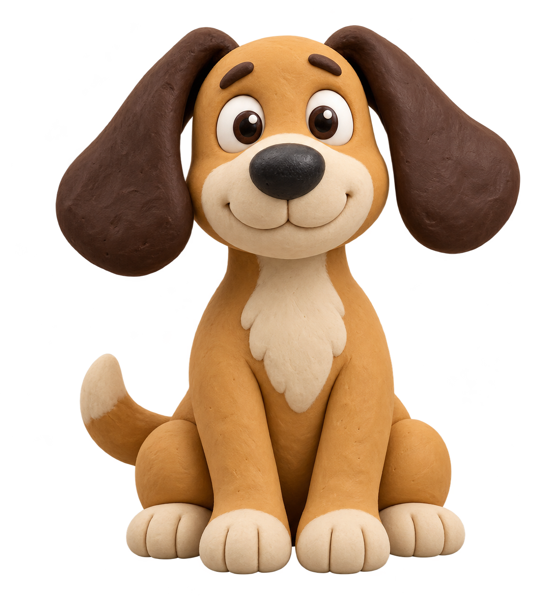

# Nexirum Avatar Creator

Create a custom desktop mascot with AI, then prepare its animations for **Nexirum Companion**.

Describe a character or supply a reference image. The skill guides an image-capable agent through character design, 14 animation states, transparent WebP atlases, visual review and an installable package.



**Open source · MIT license · Python tools · No Node.js**

New here? Follow the step-by-step [installation guide](INSTALL.md).

## Download

[Download the repository ZIP](https://github.com/nexirum/nexirum-avatar-creator/archive/refs/heads/main.zip), or choose **Code → Download ZIP** on GitHub, then extract it.

The archive includes the creation skill, installation instructions and the ready-to-use Clay Dog example. Follow [INSTALL.md](INSTALL.md) to install the skill or the example avatar.

## Try it

Install or open the skill folder [skills/create-nexirum-avatar](skills/create-nexirum-avatar) in an agent that supports skills, image generation, local file operations and Python.

For a Codex setup using its default local skills directory, copy the complete `create-nexirum-avatar` folder into `~/.codex/skills/`. On Windows, that is the `.codex/skills/` directory inside your user profile. If your host has a skill import screen, use that instead. Keep all scripts, references and assets together.

Then ask:

> Use $create-nexirum-avatar to create a friendly clay-style dog with expressive floppy ears. Prepare all 14 states, a preview and a package for Nexirum.

Or:

> Use $create-nexirum-avatar to turn my character reference into a Nexirum mascot. Preserve its identity across all animation states.

If your agent does not discover skills automatically, ask it to read [SKILL.md](skills/create-nexirum-avatar/SKILL.md) and follow the workflow.

The skill does not bundle an image model or a paid API client. New artwork requires an image-generation capability in the host. Generation availability and charges depend on that host. Existing artwork can be checked and packaged locally.

## Included example

The [Clay Dog example](examples/clay-dog) contains:

- The installable [clay-dog folder](examples/clay-dog/clay-dog).
- A standalone [interactive preview](examples/clay-dog/preview.html).
- The reference and two original sprite sheets.
- The generation prompts, reviewed packing plan and validation report.

Download the repository and open `examples/clay-dog/preview.html` locally. GitHub's file viewer will show HTML source rather than run the preview.

The owner confirmed that this dog's original package works in Nexirum Companion on **22 October 2026**. This English example preserves every atlas byte; only its display name, folder name and explanatory text are translated.

## Output format

| Property | Supplied preset |
| --- | --- |
| States | 14 |
| Frames per state | 10 |
| Frame size | 256 × 256 pixels |
| Atlas size | 2560 × 256 pixels |
| File format | Static WebP with alpha |
| Atlas size limit | 224 KiB (229,376 bytes) |
| Catalog | `animations.json` |

States: `idle`, `thinking`, `listening`, `talking`, `happy`, `warning`, `sleep`, `error`, `success`, `wake`, `hello`, `confused`, `searching`, `working`.

The preset keeps the current timings, loops and transitions. It targets Nexirum Companion; it is not a ChatGPT Pets package. See the [format reference](skills/create-nexirum-avatar/references/nexirum-format.md).

## Install an avatar in Nexirum

1. Copy its folder into `resources/avatars/` beside `NexirumCompanion.exe`.
2. Keep `animations.json` and every referenced WebP inside that folder.
3. Select the mascot in **Personal preferences → Appearance**.

For the included dog, the catalog ends up at `resources/avatars/clay-dog/animations.json`.

The spoken wake name and microphone settings are configured separately in the app. This repository does not change voice recognition or Nexirum settings.

## Local tools

**Requirements:** Python 3.10+, Pillow, NumPy, SciPy and ImageMagick. Validation alone needs only Python and Pillow. For packing, ImageMagick must provide `magick`, or both `convert` and `montage`; the ImageMagick build also needs WebP support.

Set up a local virtual environment. From the repository root, on Windows:

```powershell
python -m venv .venv
.venv\Scripts\python.exe -m pip install -r skills/create-nexirum-avatar/scripts/requirements.txt
.venv\Scripts\python.exe skills/create-nexirum-avatar/scripts/avatar_tool.py check examples/clay-dog/clay-dog
```

On Linux or macOS:

```sh
python3 -m venv .venv
.venv/bin/python -m pip install -r skills/create-nexirum-avatar/scripts/requirements.txt
.venv/bin/python skills/create-nexirum-avatar/scripts/avatar_tool.py check examples/clay-dog/clay-dog
```

Install ImageMagick separately using the appropriate installer or package manager. It is not installed by pip. Do not alter your Nexirum server's dependencies to run these tools.

### Package existing assets

Use your virtual environment's Python executable in place of `python` if needed:

```sh
python skills/create-nexirum-avatar/scripts/avatar_tool.py package examples/clay-dog/clay-dog --id clay-dog --out output/clay-dog-package --record examples/clay-dog/creation.json
```

This creates the avatar folder, ZIP, standalone HTML preview, contact sheets, installation instructions and validation report. The output directory must not already exist.

### Rebuild the included dog from its sheets

```sh
python skills/create-nexirum-avatar/scripts/avatar_tool.py pack examples/clay-dog/plan.json --out output/clay-dog-rebuilt --record examples/clay-dog/creation.json
```

The plan contains reviewed coordinates for these exact sheets. Do not reuse those coordinates for unrelated images. Lossless encoder versions may produce different file bytes; compare dimensions, appearance and validation results.

See [tool usage](skills/create-nexirum-avatar/references/tool-usage.md) for creating a new plan and handling detached symbols or unusual poses.

## Quality checks

The tools check all 14 states, frame dimensions, alpha, atlas sizes, catalog references, timing and transitions. They reject an oversized or incompatible package rather than silently removing frames or changing compression.

Generated sheets still require visual review. Inspect every state on light, dark and coloured backgrounds, then test the animation in the app. Alpha adjustment is only for a demonstrated export defect; it cannot fix missing artwork.

The example's automatic report records technical checks. The separate [verification record](examples/clay-dog/VERIFICATION.md) records the owner's app confirmation. Neither is a claim that every future generation will work without adjustment.

## Development

```sh
python skills/create-nexirum-avatar/scripts/test_avatar_tool.py
```

The tests use synthetic fixtures and make no AI or network calls. See [CONTRIBUTING.md](CONTRIBUTING.md).

## License

The code, documentation and included example assets are distributed under the [MIT License](LICENSE). Preserve the license and copyright notice when redistributing covered material.

The example artwork was AI-generated; the prompts are included. This project does not require avatars made from your own inputs to use the same license. External dependencies and image-generation services retain their own terms.


